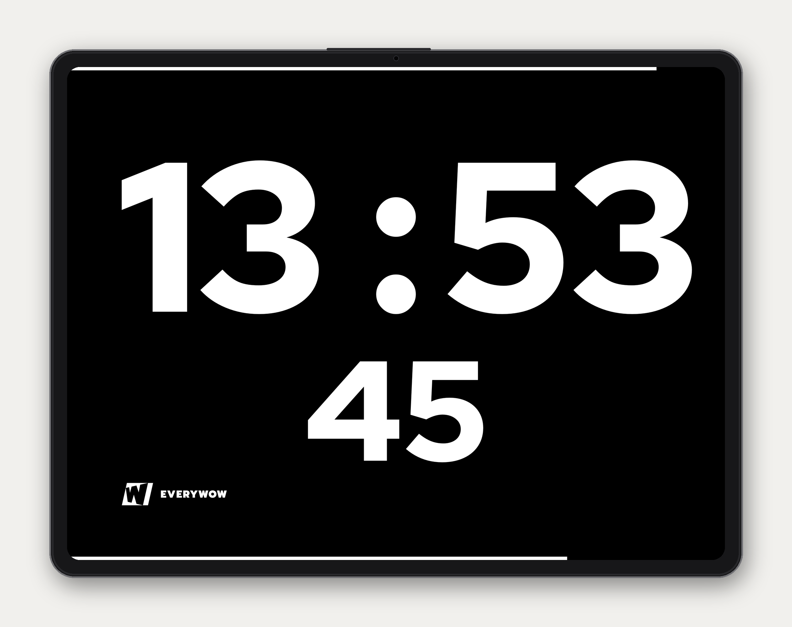
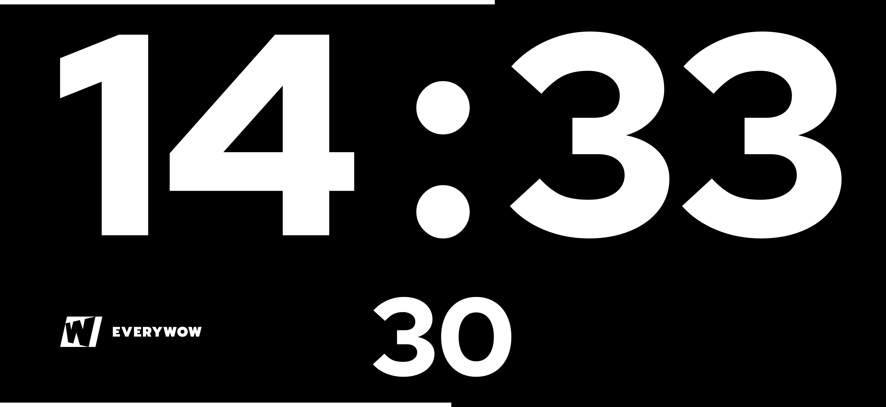

# EW Clock

**A set clock for stages, studios, and film shoots.**

EW Clock turns an iPhone, iPad, or Mac into a large 24-hour clock you can read across the room. Place it in view of the stage or crew and get on with the production.

Built by the [EVERYWOW video production team](https://everywow.ch).



## For Video Productions

EW Clock grew from a simple need on stages and film sets: show the current time clearly without demanding attention.

- No frills. The app opens directly to the clock and has no settings to manage during a production.
- The screen stays awake while the clock is active.
- EW Clock has no advertising, tracking, analytics, or network access.
- Large white numerals on pure black stay easy to read from a distance.

Use it as a stage clock for speakers, a time display for panel discussions, a production clock during a livestream, or a set clock on a film shoot.

## iPhone in Landscape



## What You See

EW Clock shows the current local time in 24-hour format. Hours and minutes fill the first line, with seconds centered beneath them. Fixed-width digit slots stop the layout from shifting when the time changes.

A white bar along the top shows elapsed time in the current hour. A second bar along the bottom shows elapsed time in the current minute. Both move continuously, so you can judge the remaining time at a glance.

On iPhone and iPad, EW Clock supports portrait and landscape. On Mac, it runs in a normal resizable window. Tap or click the EVERYWOW logo to hide it for the rest of the current app session.

## TestFlight

EW Clock is currently available to EVERYWOW’s internal testers through TestFlight for iPhone, iPad, and Mac. A public App Store release is planned. This repository contains the current source code for all three platforms.

## About EVERYWOW

EW Clock came out of the video production work at [EVERYWOW](https://everywow.ch). We’re a full-service communication and video agency. We prepare leaders and experts for the camera, run video productions and livestreams, and edit the finished videos.

Planning a corporate video, filmed event, livestream, or studio? Meet the [EVERYWOW video production team](https://everywow.ch).

## Build Locally

EW Clock requires iOS, iPadOS, or macOS 26.0 or later.

Generate the project:

```sh
xcodegen generate
```

Build and open the Mac app:

```sh
./script/build_and_run.sh
```

Run unit tests and platform build checks:

```sh
./script/test.sh
```

## Font License

The bundled EVERYWOW Display font is authorized only for EVERYWOW’s app. Its presence in this public repository does not grant permission to use it elsewhere.

© 2026 EVERYWOW AG
